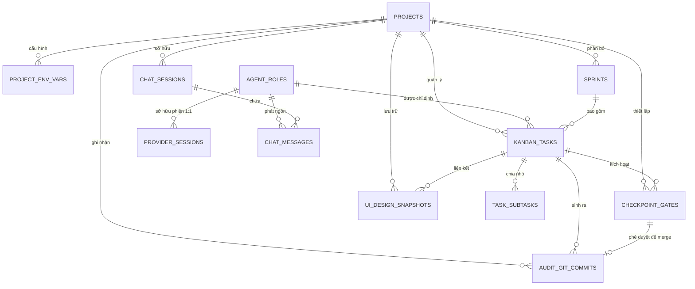

# agentP — Đặc Tả Kiến Trúc Cơ Sở Dữ Liệu SQLite
## Database Schema Specification & Data Persistence Architecture
**Phiên bản**: v1.0.0 | **Ngày ban hành**: 2026-10-23  
**Ban kỹ thuật biên soạn**:
- **Alex** (Trưởng Dự Án / Lead PM) — Tổng chủ biên & Điều phối logic
- **Marcus** (Lead Business Analyst) — Đặc tả quan hệ thực thể nghiệp vụ & Sprints
- **Maya** (Kiến Trúc Sư Hệ Thống / Systems Architect) — Thiết kế DDL, Indexes, Triggers, WAL Pragma
- **Viktor** (Lead QA & Testing) — Kiểm chuẩn toàn vẹn dữ liệu, ràng buộc Foreign Keys & Concurrency

---

## 1. Tổng Quan Kiến Trúc Lưu Trữ (Storage Architecture)

agentP sử dụng kiến trúc lưu trữ **Local-First Embedded SQLite** (`.agents/db.sqlite`) nằm ngay trong thư mục gốc của mỗi dự án. Toàn bộ thông tin từ cấu hình dự án, 14 vai trò agent, session 1:1 của agentP Core Daemon, lịch sử hội thoại có `<thinking>`, hệ thống Kanban Tri-Modal, các cổng phê duyệt Checkpoint và snapshot thiết kế Tldraw/Onlook đều được bảo toàn 100% trên máy tính của người dùng mà không phụ thuộc vào bất kỳ dịch vụ Cloud DB trả phí nào.

```
📁 Thư mục dự án (~/Projects/FoodDelivery-Loyalty-App/)
 ├── 📁 .agents/
 │    ├── 📄 db.sqlite             <-- File SQLite chính (Schema v1.0.0)
 │    ├── 📄 db.sqlite-wal         <-- Write-Ahead Log (Tốc độ đọc/ghi đồng thời)
 │    ├── 📄 db.sqlite-shm         <-- Shared Memory Index
 │    ├── 📄 project.yaml          <-- File cấu hình khai báo dự án
 │    ├── 📁 roles/                <-- Khai báo YAML của 14 nhân sự agent
 │    └── 📁 designs/              <-- Lưu trữ snapshot Tldraw & Onlook JSON
 ├── 📁 lib/                       <-- Source code Frontend (Flutter)
 ├── 📁 src/                       <-- Source code Backend (NestJS)
 └── 📁 test/                      <-- Automated Test Suites (Jest, Flutter Test)
```

### 1.1. Các Thiết Lập SQLite Bắt Buộc (Mandatory Pragmas)
Để đảm bảo UI (Tauri v2 / React 19) và 14 Sub-agent backstage có thể truy xuất đồng thời mà không bị lỗi `database is locked`, Tauri Rust Backend bắt buộc thực thi các câu lệnh Pragma sau ngay khi khởi tạo connection pool:

```sql
-- 1. Bật toàn vẹn tham chiếu khóa ngoại
PRAGMA foreign_keys = ON;

-- 2. Bật chế độ Write-Ahead Logging (WAL) cho phép đa luồng đọc và ghi song song
PRAGMA journal_mode = WAL;

-- 3. Cân bằng an toàn ổ cứng và hiệu năng ghi
PRAGMA synchronous = NORMAL;

-- 4. Thời gian chờ tối đa khi bị khóa tài nguyên (5 giây) trước khi timeout
PRAGMA busy_timeout = 5000;

-- 5. Bật mã hóa ký tự UTF-8 chuẩn
PRAGMA encoding = 'UTF-8';

-- 6. Tối ưu bộ nhớ cache trên RAM (64MB cache)
PRAGMA cache_size = -64000;
```

---

## 2. Sơ Đồ Quan Hệ Thực Thể (Entity-Relationship Diagram)



---

## 3. Chi Tiết Các Bảng Dữ Liệu (Table Schema Specifications)

### 3.1. Bảng `projects` (Dự Án Phần Mềm)
Lưu thông tin định danh của dự án hiện hành, thư mục làm việc cục bộ, và trạng thái vòng đời.

| Cột | Kiểu Dữ Liệu | Ràng Buộc | Ý Nghĩa / Ghi Chú |
| :--- | :--- | :--- | :--- |
| `project_id` | `TEXT` | `PRIMARY KEY` | UUID v4 (ví dụ: `proj_fd891a2...`) |
| `name` | `TEXT` | `NOT NULL` | Tên hiển thị (ví dụ: `FoodDelivery-Loyalty-App`) |
| `slug` | `TEXT` | `NOT NULL UNIQUE` | Định danh URL / folder safe (ví dụ: `fooddelivery-loyalty-app`) |
| `workspace_path` | `TEXT` | `NOT NULL` | Đường dẫn tuyệt đối (ví dụ: `~/Projects/FoodDelivery-Loyalty-App`) |
| `description` | `TEXT` | `NULL` | Mô tả sơ lược bài toán ban đầu từ user |
| `status` | `TEXT` | `NOT NULL DEFAULT 'active'` | Trạng thái: `initializing`, `active`, `paused`, `archived` |
| `created_at` | `DATETIME` | `NOT NULL DEFAULT CURRENT_TIMESTAMP` | Thời điểm khởi tạo |
| `updated_at` | `DATETIME` | `NOT NULL DEFAULT CURRENT_TIMESTAMP` | Thời điểm cập nhật cuối |

```sql
CREATE TABLE IF NOT EXISTS projects (
    project_id TEXT PRIMARY KEY,
    name TEXT NOT NULL,
    slug TEXT NOT NULL UNIQUE,
    workspace_path TEXT NOT NULL,
    description TEXT,
    status TEXT NOT NULL DEFAULT 'active' CHECK(status IN ('initializing', 'active', 'paused', 'archived')),
    created_at DATETIME NOT NULL DEFAULT CURRENT_TIMESTAMP,
    updated_at DATETIME NOT NULL DEFAULT CURRENT_TIMESTAMP
);

CREATE INDEX IF NOT EXISTS idx_projects_slug ON projects(slug);
```

---

### 3.2. Bảng `project_env_vars` (Biến Môi Trường & Bí Mật Cục Bộ)
Lưu trữ các cấu hình môi trường, port, credential cục bộ (được mã hóa với AES-GCM 256-bit sử dụng khóa Tauri OS Keychain).

```sql
CREATE TABLE IF NOT EXISTS project_env_vars (
    var_id TEXT PRIMARY KEY,
    project_id TEXT NOT NULL REFERENCES projects(project_id) ON DELETE CASCADE,
    key_name TEXT NOT NULL,
    encrypted_value TEXT NOT NULL,
    is_secret BOOLEAN NOT NULL DEFAULT 1,
    created_at DATETIME NOT NULL DEFAULT CURRENT_TIMESTAMP,
    updated_at DATETIME NOT NULL DEFAULT CURRENT_TIMESTAMP,
    UNIQUE(project_id, key_name)
);

CREATE INDEX IF NOT EXISTS idx_env_project_id ON project_env_vars(project_id);
```

---

### 3.3. Bảng `agent_roles` (14 Vai Trò Kỹ Thuật Trong Ban Dự Án)
Đặc tả 14 nhân sự agent, model chỉ định mặc định, và cấu hình tính cách / chuyên môn.

```sql
CREATE TABLE IF NOT EXISTS agent_roles (
    role_id TEXT PRIMARY KEY, -- e.g. 'lead_pm', 'ba_lead', 'ui_ux_designer', 'frontend_dev'
    display_name TEXT NOT NULL, -- e.g. 'Alex (Trưởng Dự Án / Lead PM)'
    code_name TEXT NOT NULL UNIQUE, -- e.g. 'Alex', 'Marcus', 'Elena', 'David', 'Carlos', 'Viktor'
    category TEXT NOT NULL CHECK(category IN ('management', 'conception', 'architecture', 'engineering', 'qa', 'devops')),
    default_model TEXT NOT NULL, -- e.g. 'claude-3-5-sonnet', 'gpt-4o', 'gemini-2-5-flash', 'deepseek-r1'
    persona_summary TEXT NOT NULL,
    system_prompt_template TEXT NOT NULL,
    color_accent TEXT NOT NULL DEFAULT '#0D9488',
    is_active BOOLEAN NOT NULL DEFAULT 1,
    created_at DATETIME NOT NULL DEFAULT CURRENT_TIMESTAMP
);
```

---

### 3.4. Bảng `provider_sessions` (Phiên 1:1 Cô Lập Qua agentP Core Daemon)
Quản lý trạng thái kết nối độc lập giữa từng vai trò kỹ thuật với các Provider qua cổng local 9090.

```sql
CREATE TABLE IF NOT EXISTS provider_sessions (
    session_id TEXT PRIMARY KEY, -- e.g. 'sess_pm_alex_01'
    project_id TEXT NOT NULL REFERENCES projects(project_id) ON DELETE CASCADE,
    role_id TEXT NOT NULL REFERENCES agent_roles(role_id) ON DELETE RESTRICT,
    provider_name TEXT NOT NULL CHECK(provider_name IN ('anthropic', 'openai', 'gemini', 'deepseek', 'local_ollama')),
    assigned_model TEXT NOT NULL,
    router_port INTEGER NOT NULL DEFAULT 9090,
    total_tokens_in INTEGER NOT NULL DEFAULT 0,
    total_tokens_out INTEGER NOT NULL DEFAULT 0,
    total_cost_usd REAL NOT NULL DEFAULT 0.0,
    latency_ms INTEGER NOT NULL DEFAULT 0,
    status TEXT NOT NULL DEFAULT 'connected' CHECK(status IN ('connected', 'idle', 'error', 'disconnected')),
    last_ping_at DATETIME NOT NULL DEFAULT CURRENT_TIMESTAMP,
    created_at DATETIME NOT NULL DEFAULT CURRENT_TIMESTAMP,
    UNIQUE(project_id, role_id)
);

CREATE INDEX IF NOT EXISTS idx_provider_sessions_role ON provider_sessions(role_id);
```

---

### 3.5. Bảng `chat_sessions` & `chat_messages` (Lịch Sử Hội Thoại Bàn Làm Việc)
Lưu toàn bộ hội thoại giữa Chủ Dự Án (User) và Alex (Lead/PM), bao gồm phần mở rộng `<thinking>` và thời gian tính toán của model.

```sql
CREATE TABLE IF NOT EXISTS chat_sessions (
    chat_session_id TEXT PRIMARY KEY,
    project_id TEXT NOT NULL REFERENCES projects(project_id) ON DELETE CASCADE,
    title TEXT NOT NULL DEFAULT 'Hội thoại chính với Lead / PM',
    status TEXT NOT NULL DEFAULT 'active' CHECK(status IN ('active', 'closed')),
    created_at DATETIME NOT NULL DEFAULT CURRENT_TIMESTAMP,
    updated_at DATETIME NOT NULL DEFAULT CURRENT_TIMESTAMP
);

CREATE TABLE IF NOT EXISTS chat_messages (
    message_id TEXT PRIMARY KEY,
    chat_session_id TEXT NOT NULL REFERENCES chat_sessions(chat_session_id) ON DELETE CASCADE,
    sender_type TEXT NOT NULL CHECK(sender_type IN ('user', 'pm_agent', 'sub_agent', 'system_event')),
    sender_role_id TEXT REFERENCES agent_roles(role_id) ON DELETE SET NULL,
    sender_name TEXT NOT NULL, -- e.g. 'Bạn (Chủ dự án)', 'Alex (Lead/PM)', 'Viktor (QA)'
    content TEXT NOT NULL, -- Nội dung hiển thị dạng Markdown
    thinking_log TEXT, -- Raw model reasoning trong thẻ <thinking>
    thought_duration_ms INTEGER DEFAULT 0, -- Thời gian suy nghĩ (vd: 8400ms = 8.4s)
    tokens_consumed INTEGER DEFAULT 0, -- Tokens tiêu thụ cho message này
    is_checkpoint_trigger BOOLEAN NOT NULL DEFAULT 0,
    checkpoint_gate_id TEXT,
    created_at DATETIME NOT NULL DEFAULT CURRENT_TIMESTAMP
);

CREATE INDEX IF NOT EXISTS idx_chat_messages_session ON chat_messages(chat_session_id, created_at ASC);
```

---

### 3.6. Bảng `sprints` & `kanban_tasks` (Hệ Thống Quản Lý Kanban Tri-Modal)
Lưu cấu trúc các chu kỳ Sprint và chi tiết từng thẻ công việc trong 6 cột tiêu chuẩn (Backlog, Conception, Architecture, Development, Quality Gate, Done).

```sql
CREATE TABLE IF NOT EXISTS sprints (
    sprint_id TEXT PRIMARY KEY,
    project_id TEXT NOT NULL REFERENCES projects(project_id) ON DELETE CASCADE,
    sprint_number INTEGER NOT NULL,
    name TEXT NOT NULL, -- e.g. 'Sprint 1: Nền Tảng Giỏ Hàng & Voucher'
    goal TEXT NOT NULL,
    status TEXT NOT NULL DEFAULT 'planned' CHECK(status IN ('planned', 'active', 'completed', 'cancelled')),
    start_date DATE NOT NULL,
    end_date DATE NOT NULL,
    created_at DATETIME NOT NULL DEFAULT CURRENT_TIMESTAMP,
    updated_at DATETIME NOT NULL DEFAULT CURRENT_TIMESTAMP,
    UNIQUE(project_id, sprint_number)
);

CREATE TABLE IF NOT EXISTS kanban_tasks (
    task_id TEXT PRIMARY KEY, -- e.g. 'TASK-101', 'TASK-102'
    project_id TEXT NOT NULL REFERENCES projects(project_id) ON DELETE CASCADE,
    sprint_id TEXT REFERENCES sprints(sprint_id) ON DELETE SET NULL,
    title TEXT NOT NULL,
    description TEXT,
    category TEXT NOT NULL CHECK(category IN ('spec', 'design', 'architecture', 'frontend', 'backend', 'qa', 'devops')),
    column_status TEXT NOT NULL DEFAULT 'backlog' CHECK(
        column_status IN ('backlog', 'conception', 'architecture', 'development', 'quality_gate', 'done')
    ),
    priority TEXT NOT NULL DEFAULT 'medium' CHECK(priority IN ('low', 'medium', 'high', 'urgent')),
    assigned_role_id TEXT REFERENCES agent_roles(role_id) ON DELETE RESTRICT,
    tokens_spent INTEGER NOT NULL DEFAULT 0,
    estimated_points INTEGER NOT NULL DEFAULT 1,
    git_branch_name TEXT,
    pr_commit_hash TEXT,
    order_index INTEGER NOT NULL DEFAULT 0,
    created_at DATETIME NOT NULL DEFAULT CURRENT_TIMESTAMP,
    updated_at DATETIME NOT NULL DEFAULT CURRENT_TIMESTAMP
);

CREATE INDEX IF NOT EXISTS idx_kanban_project_status ON kanban_tasks(project_id, column_status);
CREATE INDEX IF NOT EXISTS idx_kanban_assigned_role ON kanban_tasks(assigned_role_id);
```

---

### 3.7. Bảng `task_subtasks` (Checklist Công Việc Con)
```sql
CREATE TABLE IF NOT EXISTS task_subtasks (
    subtask_id TEXT PRIMARY KEY,
    task_id TEXT NOT NULL REFERENCES kanban_tasks(task_id) ON DELETE CASCADE,
    title TEXT NOT NULL,
    is_completed BOOLEAN NOT NULL DEFAULT 0,
    completed_at DATETIME,
    order_index INTEGER NOT NULL DEFAULT 0
);

CREATE INDEX IF NOT EXISTS idx_subtasks_task_id ON task_subtasks(task_id);
```

---

### 3.8. Bảng `checkpoint_gates` (Cổng Phê Duyệt Của Chủ Dự Án)
Ghi nhận các chốt chặn an toàn khi agent hoàn thành công việc và yêu cầu User phê duyệt trước khi commit/merge Git.

```sql
CREATE TABLE IF NOT EXISTS checkpoint_gates (
    checkpoint_id TEXT PRIMARY KEY, -- e.g. 'CHK-03'
    project_id TEXT NOT NULL REFERENCES projects(project_id) ON DELETE CASCADE,
    task_id TEXT NOT NULL REFERENCES kanban_tasks(task_id) ON DELETE CASCADE,
    title TEXT NOT NULL,
    summary TEXT NOT NULL,
    diff_stats_files INTEGER NOT NULL DEFAULT 0,
    diff_stats_insertions INTEGER NOT NULL DEFAULT 0,
    diff_stats_deletions INTEGER NOT NULL DEFAULT 0,
    automated_test_passed BOOLEAN NOT NULL DEFAULT 0,
    automated_test_details TEXT, -- e.g. 'Viktor: 8/8 tests passed'
    status TEXT NOT NULL DEFAULT 'pending' CHECK(status IN ('pending', 'approved', 'rejected', 'rework_requested')),
    user_feedback TEXT,
    resolved_at DATETIME,
    created_at DATETIME NOT NULL DEFAULT CURRENT_TIMESTAMP
);

CREATE INDEX IF NOT EXISTS idx_checkpoints_status ON checkpoint_gates(project_id, status);
```

---

### 3.9. Bảng `audit_git_commits` (Lịch Sử Commit An Toàn)
```sql
CREATE TABLE IF NOT EXISTS audit_git_commits (
    commit_id TEXT PRIMARY KEY,
    project_id TEXT NOT NULL REFERENCES projects(project_id) ON DELETE CASCADE,
    task_id TEXT REFERENCES kanban_tasks(task_id) ON DELETE SET NULL,
    checkpoint_id TEXT REFERENCES checkpoint_gates(checkpoint_id) ON DELETE SET NULL,
    commit_hash TEXT NOT NULL UNIQUE,
    branch_name TEXT NOT NULL DEFAULT 'main',
    author_agent_role_id TEXT REFERENCES agent_roles(role_id) ON DELETE SET NULL,
    commit_message TEXT NOT NULL,
    files_changed_count INTEGER NOT NULL DEFAULT 0,
    insertions_count INTEGER NOT NULL DEFAULT 0,
    deletions_count INTEGER NOT NULL DEFAULT 0,
    committed_at DATETIME NOT NULL DEFAULT CURRENT_TIMESTAMP
);

CREATE INDEX IF NOT EXISTS idx_git_commits_project ON audit_git_commits(project_id, committed_at DESC);
```

---

### 3.10. Bảng `ui_design_snapshots` (Snapshot Thiết Kế Tldraw & Onlook)
Lưu các bản vẽ wireframe Tldraw và DOM layout Onlook để đồng bộ hai chiều với mã nguồn.

```sql
CREATE TABLE IF NOT EXISTS ui_design_snapshots (
    snapshot_id TEXT PRIMARY KEY,
    project_id TEXT NOT NULL REFERENCES projects(project_id) ON DELETE CASCADE,
    task_id TEXT REFERENCES kanban_tasks(task_id) ON DELETE SET NULL,
    studio_mode TEXT NOT NULL CHECK(studio_mode IN ('tldraw_whiteboard', 'onlook_dom_editor')),
    component_name TEXT NOT NULL, -- e.g. 'CartView', 'CartCheckoutButton'
    file_path TEXT NOT NULL, -- e.g. 'lib/features/cart/cart_view.dart'
    design_data_json TEXT NOT NULL, -- Snapshot raw JSON format của Tldraw / Onlook
    tailwind_classes_json TEXT, -- Mảng JSON các class Tailwind đang áp dụng
    synced_to_code BOOLEAN NOT NULL DEFAULT 0,
    git_commit_hash TEXT,
    created_at DATETIME NOT NULL DEFAULT CURRENT_TIMESTAMP,
    updated_at DATETIME NOT NULL DEFAULT CURRENT_TIMESTAMP
);

CREATE INDEX IF NOT EXISTS idx_design_snapshots_project ON ui_design_snapshots(project_id, studio_mode);
```

---

## 4. Triggers Tự Động Hóa Dữ Liệu (Automated Database Triggers)

### 4.1. Tự Động Cập Nhật `updated_at` Khi Thay Đổi Dữ Liệu
```sql
-- Trigger cập nhật thời gian cho bảng projects
CREATE TRIGGER IF NOT EXISTS trg_projects_updated_at
AFTER UPDATE ON projects
FOR EACH ROW
BEGIN
    UPDATE projects SET updated_at = CURRENT_TIMESTAMP WHERE project_id = OLD.project_id;
END;

-- Trigger cập nhật thời gian cho bảng kanban_tasks
CREATE TRIGGER IF NOT EXISTS trg_kanban_tasks_updated_at
AFTER UPDATE ON kanban_tasks
FOR EACH ROW
BEGIN
    UPDATE kanban_tasks SET updated_at = CURRENT_TIMESTAMP WHERE task_id = OLD.task_id;
END;

-- Trigger cập nhật thời gian cho bảng sprints
CREATE TRIGGER IF NOT EXISTS trg_sprints_updated_at
AFTER UPDATE ON sprints
FOR EACH ROW
BEGIN
    UPDATE sprints SET updated_at = CURRENT_TIMESTAMP WHERE sprint_id = OLD.sprint_id;
END;
```

### 4.2. Tự Động Đồng Bộ Cột Kanban Khi Checkpoint Được Phê Duyệt
Khi User nhấn nút **"✅ Duyệt & Merge Git"** tại Checkpoint Gate, trigger này sẽ tự động chuyển trạng thái của Task liên ứng từ `quality_gate` sang `done`:

```sql
CREATE TRIGGER IF NOT EXISTS trg_checkpoint_approved_to_done
AFTER UPDATE OF status ON checkpoint_gates
FOR EACH ROW
WHEN NEW.status = 'approved' AND OLD.status != 'approved'
BEGIN
    UPDATE kanban_tasks 
    SET column_status = 'done', updated_at = CURRENT_TIMESTAMP 
    WHERE task_id = NEW.task_id;
END;
```

---

## 5. Dữ Liệu Khởi Tạo Chuẩn (Initial Seed Data)

Khi khởi tạo database mới, hệ thống nạp sẵn dữ liệu cho 14 vai trò kỹ thuật:

```sql
INSERT OR IGNORE INTO agent_roles (role_id, display_name, code_name, category, default_model, persona_summary, system_prompt_template, color_accent) VALUES
('lead_pm', 'Alex (Trưởng Dự Án / Lead PM)', 'Alex', 'management', 'claude-3-5-sonnet', 'Chịu trách nhiệm tổng thể, tương tác trực tiếp với Chủ dự án, phân bổ task.', 'Bạn là Alex, Trưởng dự án...', '#0D9488'),
('ba_lead', 'Marcus (Lead Business Analyst)', 'Marcus', 'conception', 'gpt-4o', 'Khảo sát yêu cầu, viết User Stories và tiêu chuẩn nghiệm thu.', 'Bạn là Marcus, BA Lead...', '#10B981'),
('ui_ux_designer', 'Elena (Chuyên Gia UI/UX)', 'Elena', 'conception', 'claude-3-5-sonnet', 'Thiết kế giao diện Light Mode, phối màu Teal-Amber và wireframe Tldraw.', 'Bạn là Elena, UI/UX Designer...', '#06B6D4'),
('system_architect', 'Maya (Kiến Trúc Sư Hệ Thống)', 'Maya', 'architecture', 'claude-3-5-sonnet', 'Thiết kế kiến trúc tổng thể, ERD SQLite, API contracts và module flow.', 'Bạn là Maya, System Architect...', '#8B5CF6'),
('frontend_dev', 'David (Kỹ Sư Frontend Flutter)', 'David', 'engineering', 'gemini-2-5-flash', 'Lập trình ứng dụng Flutter, quản lý state BloC, tích hợp Onlook.', 'Bạn là David, Frontend Dev...', '#3B82F6'),
('backend_dev', 'Carlos (Kỹ Sư Backend NestJS)', 'Carlos', 'engineering', 'claude-3-5-sonnet', 'Xây dựng REST API, DTO, TypeORM và business logic bảo mật.', 'Bạn là Carlos, Backend Dev...', '#6366F1'),
('qa_lead', 'Viktor (Trưởng Nhóm Kiểm Thử QA)', 'Viktor', 'qa', 'deepseek-r1', 'Viết test Jest & Flutter, phân tích logic suy luận sâu, thẩm định Checkpoint.', 'Bạn là Viktor, QA Lead...', '#D97706'),
('devops_lead', 'Liam (Kỹ Sư CI/CD & DevOps)', 'Liam', 'devops', 'gemini-2-5-flash', 'Quản lý Git workflow, Docker, mobile pairing port 8080.', 'Bạn là Liam, DevOps Lead...', '#EC4899');
```

---

## 6. Chiến Lược Di Trú Phiên Bản (Database Migration Strategy)

Mọi thay đổi cấu trúc bảng trong các bản nâng cấp tiếp theo đều được quản lý bằng bảng `schema_migrations`:

```sql
CREATE TABLE IF NOT EXISTS schema_migrations (
    version INTEGER PRIMARY KEY,
    description TEXT NOT NULL,
    applied_at DATETIME NOT NULL DEFAULT CURRENT_TIMESTAMP
);

INSERT OR IGNORE INTO schema_migrations (version, description) VALUES (1, 'Initial Schema v1.0.0 (Tri-Modal Kanban, Checkpoints, 14 Roles, Chat & Tldraw)');
```

Quy trình migration được Tauri v2 Rust Backend kiểm tra mỗi khi ứng dụng khởi động:
1. Đọc số version hiện tại trong bảng `schema_migrations`.
2. So sánh với phiên bản migration trong binary.
3. Nếu version binary lớn hơn, chạy các transaction DDL tuần tự (`ALTER TABLE`, `CREATE INDEX`).
4. Ghi nhận thời điểm migration thành công.
